<h1 align="center">Namaste 🙏, I'm Shalu Ambasta</h1>
<h3 align="center">A Full Stack Engineer from India 🇮🇳</h3>

  

  
  
  
  
   
  
  
  

 

## About Me

⚡ I break things in production so you don't have to.

Three years ago, I wrote my first `console.log("Hello World")` — today I build systems that handle real traffic, real users, and real 3 AM ☕ debugging sessions. I work mainly with **Node.js**, **React**, and **TypeScript**, lately with a lot of **Gen AI** on top, and I like shipping things that still work after launch.

👾 **Open to:** Freelance projects and full-time roles.

🧠 **Currently obsessed with:** Building AI features that actually ship — **RAG pipelines**, **AI agents** with tool calling, and **OCR + LLM** workflows like the one behind [MedLens](https://medlens.shaluambasta.in/). On the infra side, going deeper on **Kubernetes**.

🔥 **Hot take:** The best code is the code your future self won't curse at. I write for maintainability first, cleverness second.

💬 **Open to chat about:** System design rabbit holes, performance optimization, or why your perfectly working localhost code betrays you in production — I've been there, I have theories.

 

## 🚀 Tech Stack

### 💻 Languages

  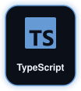
  
  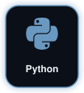
  

 

### 🤖 AI & LLMs

  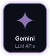
  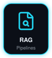
  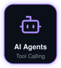
  
  
  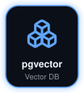
  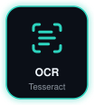
  

 

### ⚙️ Backend

  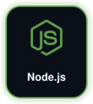
  
  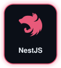
  
  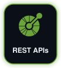
  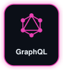
  
  
  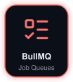

 

### 🎨 Frontend

  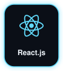
  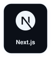
  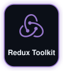
  
  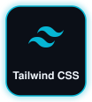
  
  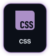

 

### 🗄️ Databases

  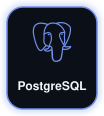
  
  
  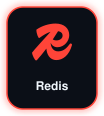
  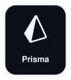

 

### ☁️ Cloud & DevOps

  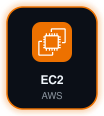
  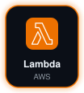
  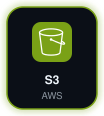
  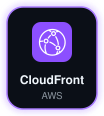
  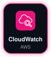
  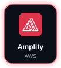
  
  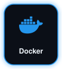
  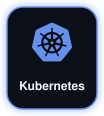
  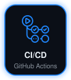
  
  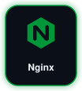
  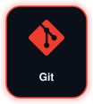

 

### 🛠️ Tools

  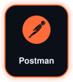
  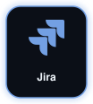

 

## 🏆 Coding Profiles

  
  
  

 

## 🔥 Streak Stats

  

 

## 🐍 Contribution Snake

  <picture>
    <source media="(prefers-color-scheme: dark)" srcset="https://raw.githubusercontent.com/ambasta-shalu/ambasta-shalu/output/github-snake-dark.svg" />
    <source media="(prefers-color-scheme: light)" srcset="https://raw.githubusercontent.com/ambasta-shalu/ambasta-shalu/output/github-snake.svg" />
    
  </picture>

 

---

  

  <b>⭐ If you like my work, consider giving a star to my repos! ⭐</b>

